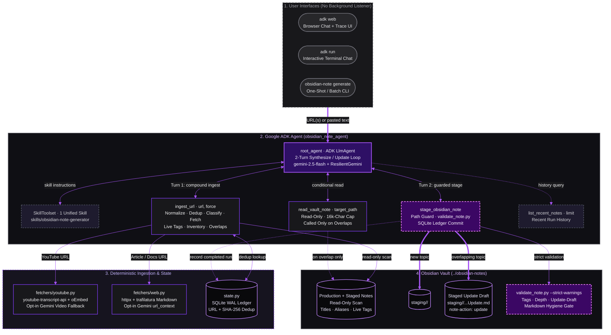
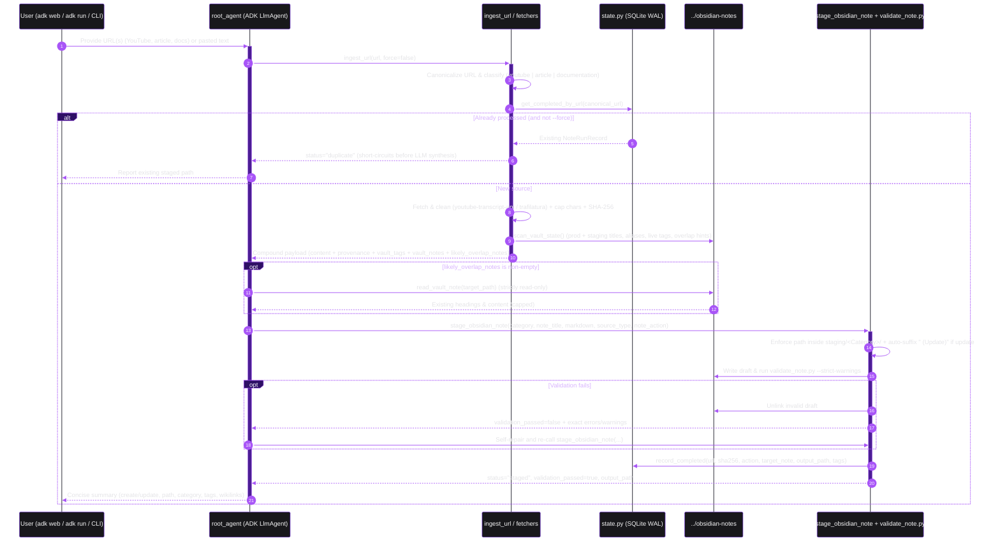
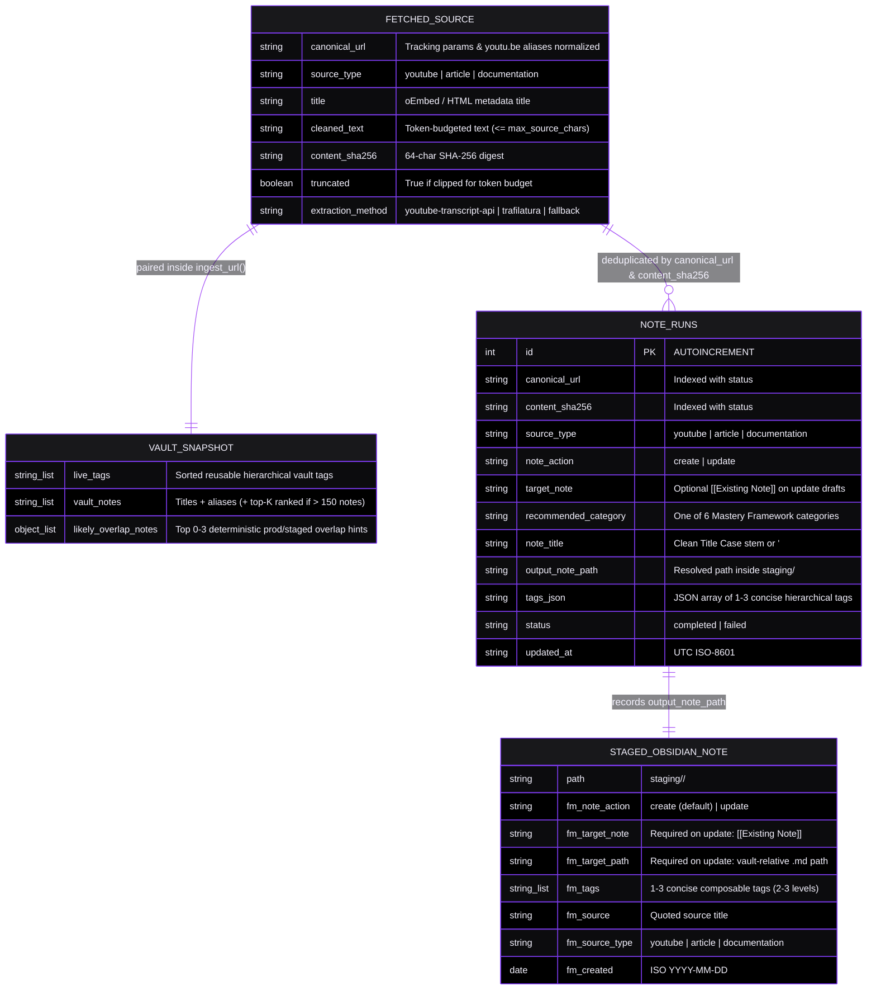

# `obsidian-note-generator`

A **Google Agent Development Kit (ADK)** URL-driven agent (`obsidian-note-agent`) and unified Antigravity skill (`obsidian-note-generator`) that turns **YouTube URLs**, **technical articles / engineering blog posts**, **official product / technical documentation**, or **pasted text** into evergreen, Mastery Framework-aligned Obsidian notes — or targeted **Update Drafts** when an overlapping note already exists — staged under `obsidian-notes/staging/<Category>/`.

Zero browser extensions and zero background filesystem watchers required.

---

## 1. Key Capabilities

- **One Agent, Any Technical URL:** Paste a YouTube link (`https://www.youtube.com/watch?v=...`), engineering blog (`https://www.databricks.com/blog/ai-harness`), or documentation page (`https://cloud.google.com/products/managed-service-for-apache-spark`) — or a batch of URLs — into `adk web`, `adk run`, or `obsidian-note generate`.
- **Automatic Overlap Detection & Update Drafts:** Scans **both** production vault notes and unpromoted `staging/` notes. When a new URL substantially overlaps an existing note, the agent drafts **only net-new additions** into `staging/<Category>/<Existing Note> (Update).md` with `note-action: update`, `target-note`, and `target-path` so you know exactly which note to merge into — never mutating existing notes directly.
- **Concise, Composable Tags:** Injects your live vault tag tree so the agent extends existing 2–3 level branches (`ai-engineering/agents/mcp`, `data-processing/frameworks/spark`) instead of inventing verbose or duplicate tags. Enforced deterministically by [validate_note.py](../../skills/obsidian-note-generator/scripts/validate_note.py).
- **Token-Efficient Design:**
  - Consolidated **1 lean unified skill** loaded via ADK `SkillToolset` (no 3-skill routing overhead or duplicated docs).
  - **2-turn normal execution** via compound `ingest_url()` (returns cleaned content + provenance + live tags + vault inventory + overlap hints in a single tool call).
  - Text-first YouTube ingestion (`youtube-transcript-api` + oEmbed), `trafilatura` HTML chrome stripping, configurable `max_source_chars` cap (`45_000`), O(1) top-K vault ranking above 150 notes, SQLite URL/SHA-256 deduplication, and `gemini-2.5-flash` default.

---

## 2. System Architecture



---

## 3. End-to-End Request Flow



---

## 4. Data & State Model



---

## 5. Component & File Reference

### Core ADK Agent & CLI (`src/obsidian_note_agent/`)

| File | Role & Responsibilities |
| :--- | :--- |
| [__init__.py](./src/obsidian_note_agent/__init__.py) | Package entrypoint exposing `root_agent` and `build_agent` for `adk web` / `adk run` auto-discovery. |
| [agent.py](./src/obsidian_note_agent/agent.py) | Builds the ADK `LlmAgent` (`root_agent`, default `gemini-2.5-flash` via `ResilientGemini`), wires the unified skill via `SkillToolset(skills=[load_skill_from_dir(...)])`, binds the 5 deterministic function tools, and holds the compact static system instruction. |
| [models.py](./src/obsidian_note_agent/models.py) | `ResilientGemini` subclass of ADK `Gemini` adding configurable exponential backoff (`HttpRetryOptions`) and ordered `fallback_models` failover on transient `429`/`500`/`503`/`504` (`UNAVAILABLE` / `RESOURCE_EXHAUSTED`) errors. |
| [cli.py](./src/obsidian_note_agent/cli.py) | Thin CLI (`obsidian-note`) built on ADK `InMemoryRunner` providing `generate <url...>` (with `--dry-run`, `--output-dir`, `--force`, `--model`), `validate-config`, and `history`. |
| [runner.py](./src/obsidian_note_agent/runner.py) | Async ADK runner helpers (`run_urls_async`, `run_pasted_text_async`) used by `cli.py`. |
| [config.py](./src/obsidian_note_agent/config.py) | Pydantic configuration (`AppConfig`: `vault`, `state`, `agent`, `ingestion`), `.env` loader (`load_dotenv`), `config.yaml` discovery, skill directory resolution, and runtime environment checks (`validate_runtime_environment`). |
| [state.py](./src/obsidian_note_agent/state.py) | SQLite WAL ledger (`note_runs` table) providing pre-LLM deduplication by `canonical_url` and `content_sha256`, plus run history tracking for both `create` and `update` actions. |

### Deterministic Fetchers (`src/obsidian_note_agent/fetchers/`)

| File | Role & Responsibilities |
| :--- | :--- |
| [classifier.py](./src/obsidian_note_agent/fetchers/classifier.py) | Canonicalizes URLs (normalizes `youtu.be` / `/shorts/` / `/live/`, strips `utm_*`/`si`/`ref` tracking params) and classifies URLs deterministically into `youtube`, `article`, or `documentation`. |
| [youtube.py](./src/obsidian_note_agent/fetchers/youtube.py) | Fetches video title + channel via YouTube oEmbed and text captions via `youtube-transcript-api` (stripping `[Music]`/timestamps into clean paragraphs), enforces `max_source_chars` budgeting, and provides an opt-in Gemini native video fallback when captions are disabled. |
| [web.py](./src/obsidian_note_agent/fetchers/web.py) | Fetches public article and documentation HTML via `httpx`, extracts clean Markdown + metadata (`title`, `author`/`vendor`, `published` date, headings) via `trafilatura`, flags HTTP 401/403/429 cleanly so users can paste text, and supports an opt-in Gemini `url_context` fallback for JS-heavy pages. |

### Vault Indexer & Guarded ADK Tools (`src/obsidian_note_agent/tools/`)

| File | Role & Responsibilities |
| :--- | :--- |
| [vault_index.py](./src/obsidian_note_agent/tools/vault_index.py) | Read-only scanner across **both** production notes in `obsidian-notes/` and unpromoted notes in `staging/` (excluding `misc/`, `.obsidian/`, `.git/`, `README.md`, category hubs, and existing `(Update)` drafts). Extracts titles, aliases, the live hierarchical tag tree, deterministic `find_likely_overlaps()` scores, and O(1) top-K inventory ranking when the vault exceeds `inventory_rank_threshold`. |
| [ingest_tools.py](./src/obsidian_note_agent/tools/ingest_tools.py) | Implements the compound `ingest_url()` and `ingest_pasted_text()` tools (returning cleaned content + provenance + live tags + vault inventory + overlap hints in 1 call to minimize agent turns) and `list_recent_notes()`. |
| [vault_tools.py](./src/obsidian_note_agent/tools/vault_tools.py) | Implements read-only `read_vault_note()` (path-contained inside `vault_path`, 16k-char cap) and guarded `stage_obsidian_note()` (validates category, blocks path traversal, auto-appends ` (Update)` on update drafts, writes strictly inside `staging/<Category>/`, runs `validate_note.py --strict-warnings` inline, unlinks invalid drafts on failure, and records valid runs in SQLite). |

### Unified Skill & Deterministic Validator (`../../skills/obsidian-note-generator/`)

| File | Role & Responsibilities |
| :--- | :--- |
| [SKILL.md](../../skills/obsidian-note-generator/SKILL.md) | Single lean skill playbook loaded by ADK `SkillToolset` (and optionally symlinked to `~/.gemini/config/skills/` for Antigravity). Defines the 3 source profiles, `create` vs. `update` decision logic, tag reuse rules, and validation loop. |
| [vault_conventions.md](../../skills/obsidian-note-generator/references/vault_conventions.md) | Authoritative spec for the 6 Mastery Framework categories, concise 2–3 level composable tag taxonomy, `create` and `update` frontmatter schemas, evergreen voice, wikilinks, and hygiene ban list. |
| [exemplars.md](../../skills/obsidian-note-generator/references/exemplars.md) | Compact style templates for a new note (`create`) and a staged Update Draft (`update`). |
| [validate_note.py](../../skills/obsidian-note-generator/scripts/validate_note.py) | Standalone stdlib validator enforcing category folders, YAML frontmatter, `source-type`, `note-action` (`target-note`, `target-path`, ` (Update).md`), tag depth (2–3 levels), conciseness (`-and-` / >22-char segment warnings), no redundant parent+child tags, no duplicate H1, and Markdown hygiene. |

### Configuration, Tests & Design History

| File / Directory | Role & Responsibilities |
| :--- | :--- |
| [pyproject.toml](./pyproject.toml) | `uv` / Hatchling package definition for `obsidian-note-agent`, `obsidian-note` CLI script, dependencies (`google-adk`, `google-genai`, `httpx`, `trafilatura`, `youtube-transcript-api`, `pydantic`, `pyyaml`, `python-dotenv`), `pytest`, and `ruff` config. |
| [.env.example](./.env.example) | Template for Gemini Developer API (`GOOGLE_API_KEY`) or Google Cloud Vertex AI (`GOOGLE_GENAI_USE_VERTEXAI`, project, location). Copy to `.env` (gitignored). |
| [config.example.yaml](./config.example.yaml) | Template for vault/staging paths, model selection, token caps, and opt-in fallbacks. Copy to `config.yaml` (gitignored). |
| [tests/](./tests/) | Hermetic unit test suite (`test_config`, `test_state`, `test_classifier`, `test_vault_index`, `test_vault_tools`, `test_fetchers`, `test_validate_note`, `test_agent_wiring`). |
| [plans/](./plans/) & [docs/](./docs/) | Phased design plans (`01_` through `04_`) and the Phase 1 vault style audit. |

---

## 6. Quick Start

### 1. Set Up Environment (`uv`) & Credentials
From `agents/obsidian-note-generator/`:

```bash
uv sync --no-editable
cp config.example.yaml config.yaml   # edit vault path or model if needed (gitignored)
cp .env.example .env                 # set GOOGLE_API_KEY or Vertex AI vars (gitignored)
```

*(Note: `--no-editable` installs the package directly into `.venv/lib/python3.12/site-packages/` instead of a `.pth` file, avoiding macOS `UF_HIDDEN` `.pth` skips inside `~/Documents` on Python 3.12.14+. Re-run `uv sync --no-editable --offline --reinstall-package obsidian-note-agent` after local code edits.)*

### 2. Validate Configuration
```bash
source .venv/bin/activate
obsidian-note validate-config
```

### 3. Run the ADK Agent (Choose Your Interface)

```bash
# Option A: ADK Browser Chat UI with live trace & tool inspection (http://localhost:8000)
adk web src

# Option B: Interactive Terminal Chat
adk run src/obsidian_note_agent

# Option C: One-Shot or Batch CLI
obsidian-note generate \
  https://www.databricks.com/blog/ai-harness \
  https://cloud.google.com/products/managed-service-for-apache-spark

# Dry-run preview (writes to /tmp/obsidian-preview without touching obsidian-notes or state.db)
obsidian-note generate https://www.databricks.com/blog/ai-harness \
  --dry-run --output-dir /tmp/obsidian-preview

# Override model or bypass deduplication
obsidian-note generate https://www.youtube.com/watch?v=mUw27wG7uFA \
  --model gemini-2.5-pro --force

# Inspect recent runs from state.db
obsidian-note history
```

*(Tip: Without activating `.venv`, prefix commands with `.venv/bin/` or `uv run --no-sync`, or install globally via `uv tool install .`.)*

### 4. Optional: Install Antigravity Skill Symlink
To also use the exact same unified skill directly inside Antigravity chat, run from the repository root:

```bash
python3 skills/install_skills.py --force
python3 skills/install_skills.py --check
```
