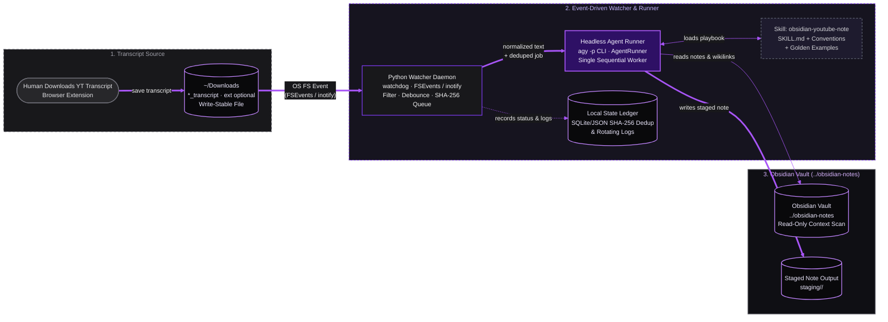

# Implementation Plan: YouTube Transcript to Obsidian Note Pipeline

## 1. Goal & Architecture

Build a standalone, cross-platform (macOS + Linux) event-driven pipeline in this repository (`yt-to-obsidian`) that watches `~/Downloads` for manually downloaded YouTube transcripts and invokes a headless Antigravity agent (`agy -p`) paired with a dedicated Antigravity Skill to produce structured Obsidian notes staged for human review in `../obsidian-notes`.



---

## 2. Locked-In Design Decisions

| Decision | Choice |
| :--- | :--- |
| **Repository** | Separate Git repository at `x-ruiz/yt-to-obsidian` (sibling to `x-ruiz/obsidian-notes`) |
| **Watch Path** | `~/Downloads` (configurable via `config.yaml`) |
| **Filename Convention** | Matches `*_transcript` with or without extension (e.g., `Protocol_Buffers_Crash_Course_transcript`, `*_transcript.txt`, `.md`, `.srt`, `.vtt`) |
| **Target OS** | Cross-platform **macOS** (`FSEvents` + `launchd`) and **Linux** (`inotify` + `systemd --user`) |
| **Vault Output Path** | `staging/<Recommended Category>/<Note Title>.md` inside `obsidian-notes` for human review before promotion |
| **Agent Backend** | Headless **`agy -p` CLI** behind a clean `AgentRunner` interface (allows evaluating the `google-antigravity` Python SDK later as a drop-in adapter) |

---

## 3. Antigravity Architecture: Agent + Skill

This pipeline uses **both** an Antigravity Agent and an Antigravity Skill with clean separation of responsibilities:

- **Antigravity Skill (`skills/obsidian-youtube-note/`)** — *The Playbook*:
  - Stores all vault-specific knowledge: the 6 Mastery Framework categories, Focus Area tags, YAML frontmatter schema, Obsidian Bases compatibility, tone/language guidelines, wikilink rules, and golden examples distilled from `obsidian-notes`.
  - Installed/symlinked into `~/.gemini/config/skills/obsidian-youtube-note` so `agy` discovers it automatically on both macOS and Linux.
  - Reusable interactively outside the watcher (e.g., from Antigravity IDE, App, or CLI).
- **Headless Antigravity Agent (`agy -p`)** — *The Executor*:
  - Spawned by the Python watcher daemon whenever a new transcript arrives.
  - Loads the `obsidian-youtube-note` skill, reads the transcript, inspects `obsidian-notes` for existing notes/wikilinks, classifies the best Mastery Framework category, and writes the staged Markdown note.
  - Abstracted behind an `AgentRunner` protocol (`src/yt_to_obsidian/runner.py`) so a future `SDKAgentRunner` using `google-antigravity` can be plugged in without modifying the watcher, parser, or skill.

---

## 4. Vault Alignment (`obsidian-notes`)

Based on `obsidian-notes/README.md` and the vault layout, generated notes must align with the **Mastery Framework**:

- **Six Top-Level Categories**:
  1. `Cloud Infrastructure`
  2. `Data Processing`
  3. `Information Security`
  4. `Software Engineering`
  5. `System Resiliency`
  6. `AI Engineering`
- **Tags**: Mapped to the **Focus Areas** defined in `obsidian-notes/README.md` (keeping folders simple and using focus areas as tags).
- **Staging Output Structure**:
  - Notes are written to:
    `obsidian-notes/staging/<Recommended Category>/<Note Title>.md`
  - Example: `Protocol_Buffers_Crash_Course_transcript` → `obsidian-notes/staging/Software Engineering/Protocol Buffers.md` (or `staging/Data Processing/...` depending on transcript content).
  - The staging path template (`staging/{category}`) will be configurable in `config.yaml` in case a different layout is desired later.
  - Because `staging/` sits inside the vault, Obsidian renders frontmatter, tags, Mermaid diagrams, and `[[Wikilinks]]` immediately for review; promoting a note is a simple drag/move into `<Recommended Category>/`.
- **Phase 1 Style Audit (Required Before Finalizing the Skill)**:
  - Inspect 4–6 representative existing notes (`Factory Method Pattern.md`, `Spring Beans.md`, `NoSQL.md`, `Software Engineering.md`, `Cloud Infrastructure.md`) and `misc/bases/Software Engineering.base` to lock down:
    - Exact YAML frontmatter fields & types (ensuring compatibility with `.base` views)
    - Tag syntax (`#tag` vs YAML `tags:` list, casing/hyphenation)
    - Heading hierarchy, callouts, code blocks, and concrete example style
    - Voice/language conventions and wikilink formatting

---

## 5. Proposed Repository Layout

```text
yt-to-obsidian/
├── plans/
│   └── 01_yt_to_obsidian_pipeline.md    # This implementation plan
├── pyproject.toml                       # Python 3.11+ project managed with uv
├── config.example.yaml                  # Documented default configuration
├── src/
│   └── yt_to_obsidian/
│       ├── __init__.py
│       ├── cli.py                       # `watch`, `process <file>`, `validate-config`, `install-skill`
│       ├── config.py                    # Cross-platform config & path resolution (macOS + Linux)
│       ├── matcher.py                   # Filename matching (`*_transcript`, optional ext) & title extraction
│       ├── watcher.py                   # watchdog FSEvents/inotify handler (created + moved + debounce)
│       ├── state.py                     # SQLite/JSON SHA-256 dedup ledger & processing history
│       ├── parser.py                    # Normalizes extensionless/.txt/.md/.srt/.vtt transcripts
│       ├── queue_worker.py              # Sequential background worker consuming matched files
│       └── runner.py                    # `AgentRunner` protocol + `AgyCliRunner` (`agy -p`)
├── skills/
│   └── obsidian-youtube-note/
│       ├── SKILL.md                     # Step-by-step agent instructions & output JSON contract
│       ├── references/
│       │   └── vault_conventions.md     # Mastery Framework, Focus Areas, frontmatter & .base rules
│       └── examples/
│           └── golden_notes.md          # Annotated style & structure examples from obsidian-notes
├── service/
│   ├── macos/
│   │   └── com.xruiz.yt-to-obsidian.plist
│   └── linux/
│       └── yt-to-obsidian.service
├── tests/
│   ├── fixtures/
│   │   └── Protocol_Buffers_Crash_Course_transcript
│   ├── test_matcher.py
│   ├── test_parser.py
│   ├── test_watcher.py
│   └── test_runner.py
└── README.md                            # Setup, config, skill install, macOS/Linux service guide
```

---

## 6. Component Specifications & Edge Cases

### 6.1 Filename Matching & Title Extraction (`matcher.py`)
- Default pattern matches files in `~/Downloads` whose stem ends with `_transcript` (case-insensitive) and either:
  - has **no extension** (e.g., `Protocol_Buffers_Crash_Course_transcript`), or
  - has an allowed transcript extension (`.txt`, `.md`, `.srt`, `.vtt`).
- Explicitly ignores browser in-progress/temporary suffixes (`.crdownload`, `.part`, `.download`, `.tmp`, `.DS_Store`).
- Derives a fallback topic title by stripping `_transcript` and replacing `_` with spaces (`Protocol_Buffers_Crash_Course_transcript` → `Protocol Buffers Crash Course`) to pass as context alongside the transcript text.

### 6.2 Event-Driven Watcher (`watcher.py`)
- Uses `watchdog.observers.Observer`, which automatically selects **FSEvents** on macOS and **inotify** on Linux.
- Non-recursive watch on `~/Downloads` (configurable) so unrelated nested folders don't cause noise.
- Handles both `on_created` and `on_moved` (`event.dest_path`) because Chromium/Firefox extensions download to a temporary file and atomically rename it on completion.
- **Write-stability debounce**: waits until the file is non-empty and its `(size, mtime)` remains unchanged across two checks (e.g., 500 ms apart) before enqueueing, avoiding partial reads.

### 6.3 Queue & Deduplication (`queue_worker.py`, `state.py`)
- Single sequential worker thread processes one transcript at a time so parallel `agy` runs never race on vault reads/writes.
- Computes SHA-256 hash of transcript contents and checks a local state store (`~/.local/state/yt-to-obsidian/state.db` on Linux/macOS, configurable):
  - Skips already-completed identical transcripts (prevents duplicates on re-download or daemon restart).
  - Records `source_path`, `sha256`, `recommended_category`, `output_note_path`, `status` (`completed` | `failed`), `error`, and `timestamp`.
- Optional post-processing behavior (configurable, default `keep`): `keep` original in `~/Downloads` or `move` to an archive folder.

### 6.4 Transcript Normalization (`parser.py`)
- Reads UTF-8 (with BOM/fallback handling) regardless of whether the file has an extension.
- Detects plain text vs. timestamped `.srt`/`.vtt` vs. `00:00` line-prefixed transcripts; preserves meaningful metadata headers (video title, channel, URL if present) and removes noisy duplicate cues so the agent receives clean context.
- Rejects empty or binary files cleanly with a logged warning.

### 6.5 Headless Agent Runner (`runner.py`)
- Defines an `AgentRunner` interface (`run(transcript_path, cleaned_text, fallback_title, config) -> RunResult`) with initial implementation `AgyCliRunner`.
- Resolves `agy` binary path via config or `shutil.which("agy")` (important for `launchd`/`systemd` where `PATH` may not include `/opt/homebrew/bin` or `~/.local/bin`).
- Executes `agy` non-interactively:
  ```sh
  agy -p "<structured prompt referencing obsidian-youtube-note skill, transcript path, vault path, and staging/{category} rule>" \
    --add-dir "<vault_path>" \
    --mode accept-edits \
    --output-format json \
    --print-timeout 300s
  ```
- Supports `--dry-run` (writes to a temporary preview directory or prints generated note without touching `obsidian-notes`) and configurable `--model` / `--effort`.
- Never runs `git commit` or `git push` on `obsidian-notes`.
- Captures stdout/stderr, exit code, and parsed JSON output; retries transient failures once or marks the ledger entry `failed` with full diagnostics.

### 6.6 Skill Workflow (`skills/obsidian-youtube-note/SKILL.md`)
1. Read the transcript file (and fallback title derived from filename).
2. Inspect `obsidian-notes/README.md` and existing filenames in the candidate category directory to discover valid `[[Wikilinks]]` and check for overlapping notes.
3. Choose the single best Mastery Framework category and applicable Focus Area tags.
4. Generate the Obsidian note conforming strictly to `references/vault_conventions.md` and `examples/golden_notes.md`:
   - Valid YAML frontmatter matching existing notes & `.base` properties
   - Structured sections, clear technical prose in the user's style, concrete examples/code snippets, wikilinks to existing vault notes, and optional Mermaid diagram / Leadership Lens callout when relevant
   - Source metadata (video title, URL/channel if present in transcript, generated date)
5. Write the note to `obsidian-notes/staging/<Recommended Category>/<Note Title>.md` (creating `staging/<Recommended Category>/` if needed).
6. Verify YAML frontmatter validity and return a concise summary with the exact output path and chosen category/tags.

### 6.7 Cross-Platform Background Service (`service/`)
- **macOS (`launchd`)**: User agent plist (`~/Library/LaunchAgents/com.xruiz.yt-to-obsidian.plist`) with explicit `PATH` including `/opt/homebrew/bin`, `RunAtLoad`, `KeepAlive`, and stdout/stderr log paths.
- **Linux (`systemd --user`)**: User service unit (`~/.config/systemd/user/yt-to-obsidian.service`) with `Restart=on-failure`, `PATH` configured for `uv`/`agy`, and journald logging.
- Optional cross-platform desktop notifications (`osascript` on macOS, `notify-send` on Linux) when a staged note is ready for review or when processing fails.

---

## 7. Phased Implementation Roadmap

### Phase 1: Vault Style Audit
- Inspect 4–6 representative notes and `misc/bases/Software Engineering.base` in `../obsidian-notes`.
- Extract concrete conventions for frontmatter, tags, headings, code/examples, wikilinks, and `.base` properties.

### Phase 2: Author & Validate the Antigravity Skill
- Create `skills/obsidian-youtube-note/` (`SKILL.md`, `references/vault_conventions.md`, `examples/golden_notes.md`).
- Add a helper command/script to symlink the skill into `~/.gemini/config/skills/obsidian-youtube-note`.
- Test manually via `agy -p` against a sample transcript (such as `Protocol_Buffers_Crash_Course_transcript`) into a dry-run directory and iterate until formatting and voice match `obsidian-notes`.

### Phase 3: Implement Watcher, Parser, Queue & Runner
- Initialize `pyproject.toml` with `uv` (`watchdog`, `pyyaml`, `pydantic`, `pytest`).
- Implement `config.py`, `matcher.py`, `parser.py`, `state.py`, `watcher.py`, `queue_worker.py`, `runner.py`, and `cli.py`.
- Verify both `yt-to-obsidian process <file>` (single-shot) and `yt-to-obsidian watch` (daemon).

### Phase 4: Cross-Platform Service & Docs
- Add `service/macos/com.xruiz.yt-to-obsidian.plist` and `service/linux/yt-to-obsidian.service`.
- Write `README.md` covering installation on macOS & Linux, `config.yaml` setup, `agy` authentication check, and service management.

### Phase 5: Testing & End-to-End Verification
- **Unit tests (`pytest`)**:
  - `matcher.py`: extensionless `Protocol_Buffers_Crash_Course_transcript`, `.txt`/`.md`/`.srt`/`.vtt` variants, ignoring `.crdownload`/`.part`/unrelated downloads.
  - `watcher.py`: `on_created` + `on_moved` rename-on-complete handling, stability debounce.
  - `state.py`: SHA-256 deduplication across restarts and failure recording.
  - `runner.py`: mocked `agy -p` command construction, PATH resolution, timeout handling, JSON parsing.
- **End-to-end verification**:
  - Run `yt-to-obsidian watch` against a test directory (then `~/Downloads`).
  - Drop a real YouTube transcript (`Protocol_Buffers_Crash_Course_transcript`), verify a single trigger fires, confirm the note lands at `obsidian-notes/staging/<Recommended Category>/<Note Title>.md`, and inspect it inside Obsidian (tags, frontmatter, wikilinks, `.base` rendering).
  - Re-drop the identical file and verify deduplication skips reprocessing.
