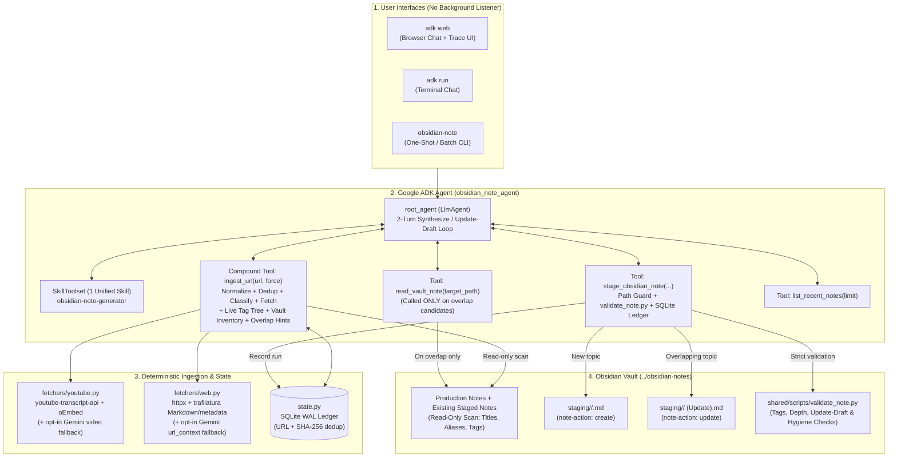

# Phase 4 Implementation Plan: Replace Listener Pipeline with a Google ADK URL-Driven Agent

**Date:** 2026-11-23  
**Scope:** Scrap the `~/Downloads` filesystem watcher (`watchdog`) and `agy -p` subprocess runner (`yt_to_obsidian`), and replace them with a **Google Agent Development Kit (ADK)** Python agent (`obsidian-note-agent`) that accepts any URL (YouTube, engineering article/blog, or technical/product documentation) — or pasted text — and generates validated, Mastery Framework-aligned Obsidian notes (or **update drafts** when an overlapping note already exists) staged under `obsidian-notes/staging/<Category>/`.

---

## 1. Viability Assessment

**Yes — this is highly viable and a major architectural simplification.**

| Dimension | Old Listener Architecture (`yt-to-obsidian`) | New ADK Agent Architecture (`obsidian-note-agent`) |
| :--- | :--- | :--- |
| **User Workflow** | Install browser extension → download `*_transcript` → keep background `watchdog` daemon running (YouTube only) | Paste 1+ URLs (YouTube, article, docs) or raw text into `adk web`, `adk run`, or `obsidian-note <url>` |
| **Multi-Source Support** | Listener only handled YouTube transcripts | Single unified agent automatically classifies and handles YouTube, articles, and documentation |
| **Duplicate / Overlap Handling** | Only listed `overlapping_notes` in JSON; still created duplicate notes | Automatically detects existing production **or** staged notes and writes a targeted **Update Draft** (`<Existing Note> (Update).md`) telling you exactly which note to update and what net-new sections to merge |
| **Validation & Self-Correction** | Spawns a brand-new `agy -p` subprocess on validation failure | Deterministic `stage_obsidian_note` tool runs `validate_note.py` inline and feeds errors back inside the same agent turn |
| **Token Efficiency** | 5–6 multi-turn tool calls + ~6.5k tokens of skill docs per run | Consolidated 1-skill design + compound `ingest_url` tool + pre-trimmed text reduces normal runs to **2 turns** (~60–70% lower input token cost) |
| **Background Processes** | Requires continuous `yt-to-obsidian watch` daemon | Zero background daemons or OS filesystem watchers |

### Key Trade-offs & Prerequisites
1. **Model Auth & Billing:** Replacing `agy -p` means the ADK agent calls Gemini directly via either:
   - **Gemini Developer API** (`GOOGLE_API_KEY` in `.env`), or
   - **Vertex AI** (`GOOGLE_GENAI_USE_VERTEXAI=TRUE`, `GOOGLE_CLOUD_PROJECT`, `GOOGLE_CLOUD_LOCATION` using `gcloud auth application-default login`).
2. **YouTube Ingestion Reliability:** On a local machine, `youtube-transcript-api` + YouTube oEmbed fetches captions + exact title/channel quickly and cheaply (text-only). If captions are disabled, an optional opt-in fallback uses Gemini's native YouTube URL understanding.
3. **Paywalled / Auth-Gated URLs:** Public articles and docs are fetched deterministically (`httpx` + `trafilatura`, with optional Gemini `url_context` fallback for JS-heavy pages). If a site blocks automated fetches or requires login, the agent cleanly reports the block and accepts pasted text right in the same chat session.

---

## 2. Evaluation: Are 3 Separate Skills Needed?

**Recommendation: No — consolidate from 3 separate skills into 1 unified skill (`obsidian-note-generator`).**

### Why 1 Unified Skill Wins Over 3 Separate Skills
1. **Fetching differences move into deterministic Python:** The biggest difference across YouTube, articles, and docs is *how to retrieve and clean the content* (`youtube-transcript-api` + oEmbed vs. `httpx` + `trafilatura`). In the ADK architecture, deterministic Python fetchers handle that completely before the LLM writes a single word.
2. **~90% of the skill rules are identical:** All three source types produce the **exact same Mastery Framework Obsidian note format** (same 6 categories, concise hierarchical tags, frontmatter rules, update-draft workflow, wikilink rules, hygiene ban list, and `validate_note.py` checks).
3. **Only ~12 lines differ at synthesis time:** A tiny source-profile table inside one `SKILL.md` (provenance keys: `channel` vs. `author`/`published` vs. `vendor`, plus 1-line extraction emphasis per source type) covers 100% of the source-specific nuances.
4. **Lower token cost & zero routing errors:**
   - Avoids injecting 3× L1 skill descriptions on every turn (~350 tokens → ~100 tokens).
   - Eliminates skill-misclassification turns on hybrid pages (e.g., a Databricks engineering blog post that reads half like product docs).
   - Eliminates 3× symlink directories and duplicated 6-step workflows.
5. **When 3 skills *would* be justified:** Only if each source produced fundamentally different output artifacts, different vault schemas, or distinct multi-step tool chains. Since all three target the exact same `obsidian-notes` evergreen reference schema, 1 unified skill is strictly cleaner and cheaper.

*(Note: If dual Antigravity compatibility is desired, `scripts/install_skill.py` installs just the single `obsidian-note-generator` skill symlink into `~/.gemini/config/skills/` and cleans up the old 3 symlinks.)*

---

## 3. Existing-Note Overlap Detection & Staged Update Drafts

To prevent duplicate notes (such as generating separate overlapping notes on the same topic), the agent handles existing notes explicitly without ever mutating production vault files:

### Detection Flow
1. **Scan BOTH production vault AND `staging/`:** `scan_vault_state()` indexes all `.md` notes in `obsidian-notes/` (excluding `misc/`, `.obsidian/`, `.git/`, `README.md`) **plus** any notes currently sitting in `staging/<Category>/` (so two related URLs processed in the same session merge cleanly instead of creating duplicates).
2. **Deterministic Candidate Surfacing:** `ingest_url()` runs lightweight local keyword/alias overlap scoring against the fetched source title + headings and returns `likely_overlap_notes` (top 0–3 matches with their vault-relative path and status `prod` or `staged`).
3. **Targeted Read-Only Inspection:** Only when `likely_overlap_notes` is non-empty (or the agent spots a strong match in the title/alias list), the agent calls `read_vault_note(target_path)` to inspect the existing note's headings and coverage.
4. **Decision Rule (`create` vs. `update`):**
   - **Substantial overlap** (same core concept, or a sub-angle that belongs as a new section inside an existing note): switch to **`note-action: update`**.
   - **Distinct concept** (only tangential reference): switch to **`note-action: create`** and reference the existing note via `[[Wikilink]]`.

### Staged Update Draft Format
Written to `staging/<Category>/<Existing Note Title> (Update).md` so it stays completely isolated from Obsidian `.base` views and leaves the original note untouched for human review:

```markdown
---
note-action: update
target-note: "[[Modern AI Architecture]]"
target-path: "AI Engineering/Modern AI Architecture.md"
tags:
  - ai-engineering/agents/harness
source: "Building Production AI Agent Harnesses"
source-type: article
author: "Databricks Engineering Blog"
url: "https://www.databricks.com/blog/ai-harness"
created: 2026-11-23
---
> [!NOTE]
> **Draft Modification for [[Modern AI Architecture]]** (`AI Engineering/Modern AI Architecture.md`)
> **Why update instead of new note:** The target note already covers LLM core layers, MCP, RAG, and agent loops. This source adds concrete harness governance, eval-gate patterns, and production control-plane design without duplicating existing sections.

## Proposed Frontmatter Additions
- **Add tags (if missing):** `ai-engineering/agents/harness`
- **Append source / url:** `"Building Production AI Agent Harnesses"` (`https://www.databricks.com/blog/ai-harness`)

## Proposed Additions to `## Guarded Agent Execution Loop`
*(Net-new content only — ready to copy/merge into the existing note)*
...

## Proposed New Section: `## Continuous Evaluation Gates`
...
```

### Validator Support (`validate_note.py`)
- Accepts optional `note-action` (`create` default, or `update`).
- When `note-action: update`:
  - Requires non-empty `target-note` (wikilink format `[[...]]`) and `target-path` (vault-relative `.md` path).
  - Requires filename ending with ` (Update).md`.
  - Still enforces all tag, frontmatter, and Markdown hygiene rules strictly.

---

## 4. Concise, Composable Tag Taxonomy (Built On Each Other)

Replace verbose multi-word slugs (e.g., `ai-engineering/agent-deployment-and-development/agent-architecture`, `information-security/authentication-and-authorization`) with **short, reusable, composable 2–3 level hierarchical tags** (`<pillar>/<domain>[/<topic>]`):

### Proposed Canonical Root + Level-2 Domains
*(Level-1 pillar slugs match your existing `software-engineering/...` notes so existing vault notes don't break; Level-2 and Level-3 slugs are concise 1–2 word nouns with zero `-and-` filler so tags cleanly nest and compose.)*

| Category Folder | Level-1 Pillar | Concise Level-2 Domains (Composable) | Example Level-3 Extensions |
| :--- | :--- | :--- | :--- |
| `AI Engineering` | `ai-engineering` | `agents`, `models`, `ml-pipelines`, `mlops`, `safety` | `ai-engineering/agents/mcp`, `ai-engineering/agents/rag`, `ai-engineering/agents/memory`, `ai-engineering/agents/harness`, `ai-engineering/models/evals` |
| `Data Processing` | `data-processing` | `pipelines`, `frameworks`, `storage`, `streaming`, `quality` | `data-processing/frameworks/spark`, `data-processing/storage/iceberg`, `data-processing/streaming/kafka`, `data-processing/pipelines/dbt` |
| `Cloud Infrastructure` | `cloud-infrastructure` | `architecture`, `iac`, `containers`, `networking`, `services` | `cloud-infrastructure/containers/k8s`, `cloud-infrastructure/iac/terraform`, `cloud-infrastructure/services/gcp` |
| `Information Security` | `information-security` | `appsec`, `auth`, `crypto`, `threats`, `compliance` | `information-security/auth/oauth2`, `information-security/crypto/tls`, `information-security/threats/prompt-injection` |
| `Software Engineering` | `software-engineering` | `principles`, `patterns`, `frameworks`, `languages`, `testing`, `cicd` | `software-engineering/patterns/creational`, `software-engineering/languages/java`, `software-engineering/frameworks/spring`, `software-engineering/frameworks/protobuf` |
| `System Resiliency` | `system-resiliency` | `observability`, `fault-tolerance`, `chaos`, `incidents`, `dr` | `system-resiliency/fault-tolerance/circuit-breakers`, `system-resiliency/observability/otel` |

*(Note: Existing vault tags `software-engineering/design-patterns` and `software-engineering/design-principles` can either stay as-is for Level 2 or be kept as accepted aliases so existing notes remain consistent.)*

### Reuse-First Composability Rules (Enforced in Tool + Validator)
1. **Live Tag Tree Injection (~50 tokens):** `ingest_url()` includes the sorted list of every tag currently used in `obsidian-notes` (and `staging/`).
2. **Extend Existing Branches First:** Before creating a new Level-2 or Level-3 segment, the agent checks the live tag tree and builds on an existing prefix (e.g., if `ai-engineering/agents` exists, a new MCP note uses `ai-engineering/agents/mcp` rather than creating a parallel branch).
3. **Validator Rules in `validate_note.py`:**
   - **Max depth:** 2–3 segments (`pillar/domain` or `pillar/domain/topic`; reject 1-segment flat tags and 4+ segment over-nested tags).
   - **Conciseness check:** Warn on `-and-` filler inside slugs or any single segment > 22 characters.
   - **No redundant parent + child:** Reject emitting both `ai-engineering/agents` and `ai-engineering/agents/mcp` on the same note (Obsidian matches parent tags automatically).
   - **Count:** Strictly 1–3 tags per note.

---

## 5. Token Optimization Strategy

Every design choice targets minimizing input + multi-turn tokens without sacrificing note quality:

| Optimization | Mechanism | Estimated Savings |
| :--- | :--- | :--- |
| **1. Consolidate 3 skills → 1 lean skill** | Single compact `SKILL.md` (~800 tokens) + dense `vault_conventions.md` (~1,100 tokens) + compact `exemplars.md` (~700 tokens, loaded only when needed) instead of 3 skills + 6.5k tokens of verbose docs | **~55–65% fewer static skill tokens** per turn |
| **2. Collapse 5–6 turns → 2 turns via compound `ingest_url`** | `ingest_url(url)` returns cleaned text + provenance + `source_type` + `vault_tags` + `vault_notes` + `likely_overlap_notes` in **one tool call**. Normal flow becomes: Turn 1 `ingest_url` → Turn 2 `stage_obsidian_note` (no separate `get_vault_inventory` or skill-routing round-trips) | **~60–70% fewer total input tokens** (avoids re-sending the entire transcript across 4 extra turns) |
| **3. Conditional vault reads** | Agent only calls `read_vault_note()` when `likely_overlap_notes` flags an actual overlap candidate | Saves 1–2 turns + full note body tokens on non-overlapping topics |
| **4. Deterministic pre-cleaning & source char cap** | Strip timestamps, HTML chrome/nav/footers via `trafilatura`, and enforce configurable `max_source_chars` (default `45_000` chars ≈ ~11k tokens) with clean section-preserving truncation for multi-hour transcripts | Prevents accidental 100k+ token spikes on huge videos/docs |
| **5. Text-first YouTube ingestion** | Default to `youtube-transcript-api` (~2k–12k tokens) instead of raw video frames (~150k+ tokens for 10 min); Gemini native video fallback is opt-in only when captions don't exist | **~10–30× cheaper** per YouTube video |
| **6. Vault inventory O(1) scaling cap** | Send all titles+aliases when vault ≤ 150 notes (~200–1,200 tokens); above 150 notes, deterministically rank top-40 keyword/BM25 candidates in Python | Keeps vault context bounded forever |
| **7. Static prefix caching + Flash default** | Keep agent instructions + skill prefix stable for Gemini implicit/explicit context caching; default to `gemini-2.5-flash` with `--model gemini-2.5-pro` override | **~5–10× lower $/token** vs. Pro + cached prefix discount on batch runs |
| **8. Pre-LLM SQLite deduplication** | `ingest_url()` short-circuits duplicate URLs / content SHA-256 hashes before the LLM synthesizes anything (unless `force=True`) | **100% savings** on accidental re-runs |

---

## 6. Target Architecture



---

## 7. Repository Structure (After Migration)

```text
obsidian-note-generator/
├── README.md
├── pyproject.toml                       # Package: obsidian-note-agent (drops watchdog; adds google-adk)
├── uv.lock
├── .env.example                         # GOOGLE_API_KEY or Vertex AI config (gitignored .env)
├── config.example.yaml                  # Vault path, staging dir, model, max_source_chars, fallback toggles
├── skill/                               # Single unified skill (ADK load_skill_from_dir + Antigravity compatible)
│   ├── SKILL.md                         # Lean workflow + 12-line source profile table + create vs. update rules
│   ├── references/
│   │   ├── vault_conventions.md         # Concise composable tag taxonomy, create/update schemas, hygiene rules
│   │   └── exemplars.md                 # Compact create + update-draft exemplars
│   └── scripts/
│       └── validate_note.py             # Validates create + update drafts, tag conciseness/depth, source types
├── src/
│   └── obsidian_note_agent/
│       ├── __init__.py                  # Exposes root_agent for `adk web` / `adk run`
│       ├── agent.py                     # root_agent (LlmAgent) + SkillToolset + FunctionTools
│       ├── config.py                    # AppConfig
│       ├── state.py                     # SQLite WAL `note_runs` ledger (URL + SHA-256)
│       ├── cli.py                       # `obsidian-note generate <url...>`, `validate-config`, `history`
│       ├── fetchers/
│       │   ├── __init__.py
│       │   ├── classifier.py            # URL canonicalization & source-type classification
│       │   ├── youtube.py               # youtube-transcript-api + oEmbed (+ opt-in Gemini video fallback)
│       │   └── web.py                   # httpx + trafilatura (+ opt-in Gemini url_context fallback)
│       └── tools/
│           ├── __init__.py
│           ├── vault_index.py           # Read-only vault + staging scanner (titles, aliases, live tag tree, overlap ranker)
│           ├── ingest_tools.py          # Compound `ingest_url` + `ingest_pasted_text` + `list_recent_notes`
│           └── vault_tools.py           # `read_vault_note` + guarded `stage_obsidian_note` (create & update)
├── docs/
├── plans/
│   └── 04_adk_url_note_generator_agent.md
└── tests/
    ├── test_classifier.py
    ├── test_config.py
    ├── test_fetchers.py
    ├── test_state.py
    ├── test_vault_index.py
    ├── test_vault_tools.py
    ├── test_validate_note.py
    └── test_agent_wiring.py
```

### Removed Components
- Entire `src/yt_to_obsidian/` listener package (`watcher.py`, `matcher.py`, `queue_worker.py`, `runner.py`, `notifier.py`, `parser.py`) and `watchdog` dependency.
- Redundant 3-skill split (`skills/obsidian-youtube-note`, `skills/obsidian-article-note`, `skills/obsidian-docs-note` + `shared/` symlink indirection) consolidated into one clean `skill/` directory.

---

## 8. Phased Implementation Roadmap

### Phase 1: Cleanup, Consolidation & Concise Taxonomy
- Remove `src/yt_to_obsidian/` and obsolete watcher tests.
- Consolidate the 3 skills + `shared/` into a single lean `obsidian-note-generator/skill/` directory (compatible with both ADK `load_skill_from_dir` and `scripts/install_skill.py`).
- Rewrite `vault_conventions.md` with the concise composable tag taxonomy and update-draft specification; compress `exemplars.md` for low token footprint.
- Extend `validate_note.py` to validate:
  - `note-action: create | update` (requiring `target-note`, `target-path`, and ` (Update).md` filename on updates),
  - concise composable tag rules (depth 2–3, no `-and-` filler / overly long segments, no redundant parent+child tag pairs, max 1–3 tags).
- Update [pyproject.toml](../pyproject.toml) (`google-adk`, `google-genai`, `youtube-transcript-api`, `httpx`, `trafilatura`, `pydantic`, `pyyaml`, `python-dotenv`; drop `watchdog`).

### Phase 2: Vault Indexer, Fetchers & Deterministic Tools
- Implement `config.py` and URL/SHA-256 `state.py`.
- Implement `tools/vault_index.py`: scans production vault + `staging/`, extracts titles, aliases, live deduplicated tag tree, and top overlap candidates (with O(1) top-40 keyword ranking when vault > 150 notes).
- Implement `fetchers/classifier.py`, `fetchers/youtube.py` (with `max_source_chars` budgeting), and `fetchers/web.py`.
- Implement `tools/ingest_tools.py` (compound `ingest_url` + `ingest_pasted_text` for paywalled content + `list_recent_notes`) and `tools/vault_tools.py` (`read_vault_note` + path-guarded `stage_obsidian_note` supporting both `create` and `update` drafts + inline `validate_note.py` verification).

### Phase 3: ADK `root_agent`, `SkillToolset` & CLI
- Implement `src/obsidian_note_agent/agent.py` & `__init__.py` exposing `root_agent` wired with `SkillToolset([load_skill_from_dir(...)])` and the minimal toolset.
- Implement `cli.py` (`obsidian-note generate <url...>`, `validate-config`, `history`) using ADK `Runner` + `InMemorySessionService`.
- Update `scripts/install_skill.py` (if dual Antigravity compatibility is kept) to install the consolidated skill and prune stale symlinks.

### Phase 4: Verification & Live Smoke Tests
- Write and run comprehensive unit tests (`pytest` + `ruff check`) covering URL classification, mock YouTube/web fetchers, live tag tree extraction, overlap detection, `create` vs. `update` staging, path-traversal blocking, tag conciseness/parent-child validation, and ADK `root_agent` wiring.
- Run live `--dry-run` smoke tests against:
  1. A public YouTube URL (`create` flow),
  2. `https://www.databricks.com/blog/ai-harness` (testing `update` draft flow against existing `Modern AI Architecture` if overlapping, or `create`),
  3. `https://cloud.google.com/products/managed-service-for-apache-spark` (`documentation` flow).

---

## 9. Open Decisions Before Implementation

1. **Gemini Auth Backend:** Gemini Developer API (`GOOGLE_API_KEY`) or Google Cloud Vertex AI (ADC + GCP project/region)?
2. **Default Model:** `gemini-2.5-flash` *(recommended for token cost)* or `gemini-2.5-pro`?
3. **Existing Vault Tag Migration:** Keep Level-1 pillar slugs (`software-engineering`, `ai-engineering`, `data-processing`, etc.) matching your existing notes while shortening Level 2–3 (`ai-engineering/agents/mcp`), OR shorten Level 1 too (e.g., `ai/agents/mcp`, `swe/patterns/creational`)?
4. **YouTube Fallback (no captions):** Opt-in Gemini native YouTube video fallback when captions are disabled, or fail fast and ask for pasted text?
5. **Dual Antigravity Symlink:** Keep `scripts/install_skill.py` symlinking the single consolidated skill into `~/.gemini/config/skills/` as well, or make it ADK-only?
