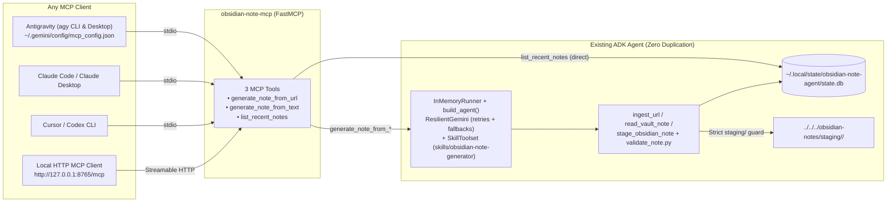

# Phase 5 Implementation Plan: Wrap `obsidian-note-agent` (ADK) as a Cross-Client MCP Server

**Date:** 2026-11-23  
**Scope:** Wrap the Google ADK `obsidian_note_agent` in a thin, single-purpose **Model Context Protocol (MCP)** server (`obsidian-note-mcp`) so **Antigravity (`agy` CLI & Desktop App)** and **non-Gemini clients** (Claude Code, Claude Desktop, Cursor, Codex CLI) can delegate note generation to your ADK agent in a single tool call—without dumping long transcripts/articles into the host client's chat context.

---

## 1. Design Principle: Thin ADK Delegation Wrapper

Instead of exposing low-level scraping/writing tools and asking Claude or `agy` to re-implement the note-generation workflow, the MCP server wraps **your ADK agent directly**:

- **1-Call Context Isolation:** The calling client (`agy`, Claude Code, Cursor) sends a URL and receives only a compact summary (action `create`/`update`, staged file path, category, tags, wikilinks). The raw 10k–45k character transcript/article stays inside ADK and never bloats your coding session.
- **Minimal Tool Schema Footprint:** Exposes only **3 small tools** (~150 tokens of tool schemas total in any client), no confusing mode flags, and zero duplicated logic.
- **Consistent Behavior Everywhere:** `adk web`, `adk run`, `obsidian-note` CLI, and `obsidian-note-mcp` all execute the exact same `build_agent()` → `ResilientGemini` → `SkillToolset` → `stage_obsidian_note` → `validate_note.py` pipeline.
- **Same Hard Safety Boundary:** All writes still pass exclusively through `stage_obsidian_note` (`obsidian-notes/staging/<Category>/` path containment + strict validation). Production vault notes remain untouchable.

---

## 2. Target Architecture



---

## 3. Exposed MCP Tools

| Tool | Signature | What It Does |
| :--- | :--- | :--- |
| **`generate_note_from_url`** | `(urls: list[str], force: bool = False, dry_run: bool = False, output_dir: str = "", model: str = "") -> dict` | Runs your ADK `obsidian_note_agent` (`build_agent` + `InMemoryRunner`) over one or more YouTube, engineering article, or technical documentation URLs. Automatically classifies, deduplicates via SQLite, detects overlapping prod/staged notes for Update Drafts, validates with `validate_note.py`, and returns a concise summary. |
| **`generate_note_from_text`** | `(text: str, title: str, source_type: str = "article", url: str = "", force: bool = False, dry_run: bool = False, output_dir: str = "", model: str = "") -> dict` | Same ADK delegation flow for paywalled articles, pasted transcripts, or internal docs where direct HTTP fetch isn't possible. |
| **`list_recent_notes`** | `(limit: int = 15) -> dict` | Fast read-only query against `~/.local/state/obsidian-note-agent/state.db` (zero LLM tokens) returning recent `create` and `update` runs. |

---

## 4. Engineering Details

### 4.1 Stdio Hygiene & Host-Independent Startup (`src/obsidian_note_agent/mcp_server.py`)
1. **Strict `stdout` cleanliness:** In `stdio` transport, `stdout` carries exclusively JSON-RPC frames. Before importing `httpx`/`trafilatura`/`google.adk`, suppress the `urllib3` `DependencyWarning` and direct all Python `logging` exclusively to `sys.stderr`.
2. **`cwd="/"` resilience:** External MCP clients (Claude Desktop, `agy`, Cursor) often launch stdio servers from `/` or `~`. Support `--config PATH` and `--env-file PATH` flags (plus `OBSIDIAN_NOTE_AGENT_CONFIG` env var) and resolve `project_root()` / `repo_root()` from `sys.prefix` / `__file__` so `.env`, `config.yaml`, `skills/obsidian-note-generator/`, and `../../../obsidian-notes` always resolve regardless of working directory.
3. **Clear Auth Diagnostics:** If `.env` / Gemini credentials are missing when `generate_note_from_*` is called, return a clean structured error pointing to `agents/obsidian-note-generator/.env` rather than crashing the server.
4. **Transports:**
   - Default: `obsidian-note-mcp` (`stdio` — works with `agy`, Antigravity Desktop, Claude Code, Claude Desktop, Cursor, Codex).
   - Optional: `obsidian-note-mcp --transport streamable-http --host 127.0.0.1 --port 8765` (localhost-only by default, exposes `/mcp`).

### 4.2 Repository Changes
```text
agents/obsidian-note-generator/
├── pyproject.toml                       # Add `mcp>=1.6,<2.0` + script `obsidian-note-mcp`
├── src/obsidian_note_agent/
│   ├── mcp_server.py                    # NEW: FastMCP server wrapping build_agent + InMemoryRunner
│   ├── runner.py                        # NEW (shared helper): async run_urls / run_pasted_text reused by both cli.py & mcp_server.py
│   └── cli.py                           # Reuse runner.py + add `obsidian-note mcp-config [--client agy|claude|cursor|codex]`
├── tests/
│   └── test_mcp_server.py               # NEW: unit tests + real subprocess stdio initialize & tools/list test from cwd=/tmp
└── README.md                            # Add MCP setup section for agy, Claude Code/Desktop, Cursor, Codex
```

### 4.3 Client Registration Examples

**Antigravity (`agy` CLI & Desktop App) — `~/.gemini/config/mcp_config.json`:**
```json
{
  "mcpServers": {
    "obsidian-note-generator": {
      "command": "/Users/xavierruiz/Documents/repositories/x-ruiz/project-skills/agents/obsidian-note-generator/.venv/bin/obsidian-note-mcp"
    }
  }
}
```

**Claude Code:**
```bash
claude mcp add obsidian-note-generator -- \
  /Users/xavierruiz/Documents/repositories/x-ruiz/project-skills/agents/obsidian-note-generator/.venv/bin/obsidian-note-mcp
```

**Claude Desktop / Cursor / Codex:** Printed with exact local paths via `obsidian-note mcp-config --client <name>`.

---

## 5. Phased Implementation Roadmap

### Phase 1: Packaging & Shared ADK Runner
- Add `"mcp>=1.6,<2.0"` and `obsidian-note-mcp = "obsidian_note_agent.mcp_server:main"` to [pyproject.toml](../pyproject.toml) and run `uv sync --no-editable`.
- Extract shared async runner helpers (`run_urls_async`, `run_pasted_text_async`) into `src/obsidian_note_agent/runner.py` so `cli.py` and `mcp_server.py` share one codepath.

### Phase 2: `FastMCP` Server & Config Helper
- Implement `src/obsidian_note_agent/mcp_server.py` exposing `generate_note_from_url`, `generate_note_from_text`, and `list_recent_notes` over `stdio` (default) and `streamable-http`, with strict stderr-only logging and `cwd="/"` path safety.
- Add `obsidian-note mcp-config [--client agy|claude|cursor|codex]` to [cli.py](../src/obsidian_note_agent/cli.py).
- Update [README.md](../README.md) with MCP setup and usage examples.

### Phase 3: Verification
- Add `tests/test_mcp_server.py` covering:
  - Exact 3 registered MCP tools and schemas,
  - `list_recent_notes` direct SQLite read,
  - Mocked `generate_note_from_url` and `generate_note_from_text` delegation through `runner.py`,
  - **Real subprocess stdio handshake test:** spawn `.venv/bin/obsidian-note-mcp` with `cwd=/tmp`, send JSON-RPC `initialize` + `tools/list`, and assert valid JSON-RPC responses with **zero stray stdout noise**.
- Run `pytest`, `ruff check`, and `obsidian-note validate-config`.
- Optional: Register in `~/.gemini/config/mcp_config.json` and verify `agy mcp list`.

---

## 6. Open Decision Before Implementation

- **Register in `~/.gemini/config/mcp_config.json` automatically?** Should implementation add the `obsidian-note-generator` entry to your global `~/.gemini/config/mcp_config.json` so `agy` picks it up right away, or just print the snippet via `obsidian-note mcp-config`?
