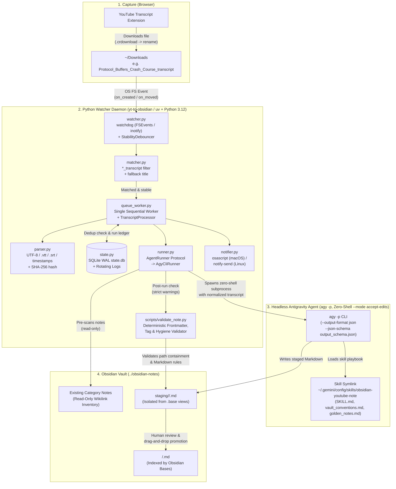
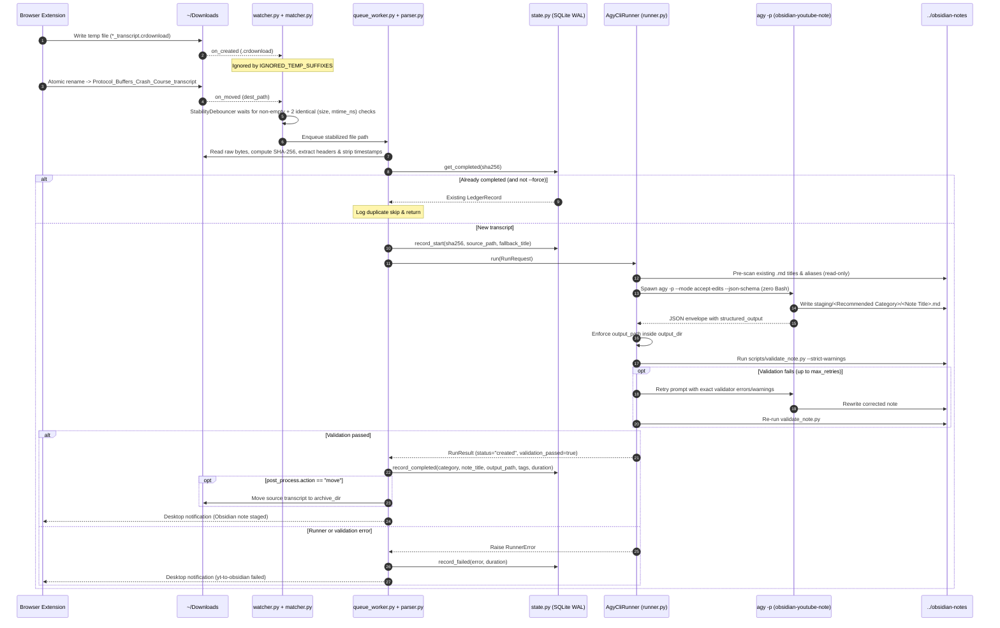
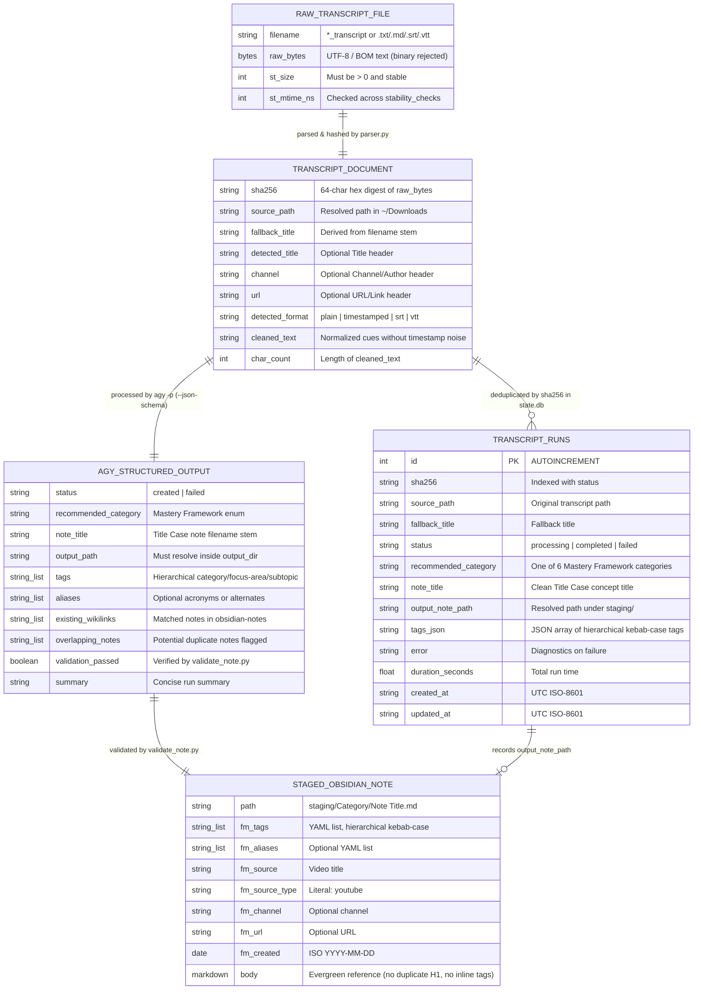

# `obsidian-youtube-note`

An Antigravity Skill and cross-platform (macOS + Linux) event-driven Python pipeline (`yt-to-obsidian`) that watches `~/Downloads` for downloaded YouTube transcripts and automatically generates evergreen, Mastery Framework-aligned Obsidian reference notes staged for human review under `obsidian-notes/staging/<Category>/<Title>.md`.

---

## 1. Architecture Diagram



---

## 2. End-to-End Processing Flow



---

## 3. Data & State Diagram



---

## 4. Quick Start

### Install the Skill Symlink
From the repository root:

```bash
python3 scripts/install_skill.py obsidian-youtube-note
python3 scripts/install_skill.py --check
```

### Set Up the Python Environment (`uv`)
From `obsidian-youtube-note/`:

```bash
uv sync --no-editable
cp config.example.yaml config.yaml   # edit paths if needed (gitignored)
```

*(Note: `--no-editable` installs the package directly into `.venv/lib/python3.12/site-packages/` instead of a `.pth` file, avoiding macOS `UF_HIDDEN` `.pth` skips inside `~/Documents` on Python 3.12.14+.)*

### CLI Commands

```bash
# Validate config, paths, agy binary, and skill symlink
.venv/bin/yt-to-obsidian validate-config

# Single-shot dry run (writes to preview directory; does not touch obsidian-notes or state.db)
.venv/bin/yt-to-obsidian process tests/fixtures/Protocol_Buffers_Crash_Course_transcript \
  --dry-run --output-dir /tmp/yt-preview

# Process a single transcript into obsidian-notes/staging/<Category>/<Title>.md
.venv/bin/yt-to-obsidian process ~/Downloads/Protocol_Buffers_Crash_Course_transcript

# Run the continuous directory watcher
.venv/bin/yt-to-obsidian watch

# Inspect recent processing runs from state.db
.venv/bin/yt-to-obsidian history
```

---

## 5. Repository Contents

- [SKILL.md](./SKILL.md) — Antigravity skill instructions and 6-step workflow
- [references/vault_conventions.md](./references/vault_conventions.md) — Mastery Framework categories, canonical hierarchical tags, frontmatter schema, and hygiene rules
- [examples/golden_notes.md](./examples/golden_notes.md) — Annotated style exemplars from `obsidian-notes`
- [resources/output_schema.json](./resources/output_schema.json) — JSON Schema enforced on `agy -p` output
- [scripts/validate_note.py](./scripts/validate_note.py) — Standalone stdlib note validator
- [src/yt_to_obsidian/](./src/yt_to_obsidian/) — Watcher, parser, SQLite ledger, queue worker, and `AgyCliRunner`
- [plans/](./plans/) — Phased implementation plans (`01_` through `03_`)
- [docs/phase1_vault_style_audit.md](./docs/phase1_vault_style_audit.md) — Full Phase 1 vault style audit
