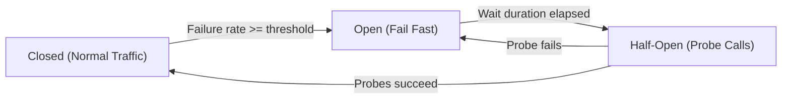

# Golden Note Exemplars (`obsidian-notes`)

Curated, annotated excerpts distilled from the highest-craft notes in `../obsidian-notes`, followed by a synthetic YouTube-to-Obsidian target example demonstrating the required provenance frontmatter and hierarchical tags.

---

## Exemplar 1: Full Deep-Dive Structure (from `Software Engineering/Builder Pattern.md`)

**Why it works:**
- Opens immediately after YAML frontmatter with a crisp 2-sentence definition bolding the core takeaway (no duplicate `# Builder Pattern` H1).
- Grounds the Java example in realistic data-platform classes (`TableConfig`, `commitRetries`, `purgeOnDelete`).
- Pairs `Key Components` + runnable code + `Notes & Pitfalls` + `> [!IMPORTANT]` caveat + conceptual breakdown + styled Mermaid diagram.

```markdown
---
tags:
  - software-engineering/design-patterns/creational-patterns
---
Separates the construction of a complex object from its representation, allowing the same construction process to produce different representations or configurations. **Used for simplifying the construction of a complex object**.

### Key Components
- **Product:** The complex object being built (usually immutable).
- **Builder:** An interface or class defining the step-by-step methods to configure attributes.
- **Director (Optional in modern Java):** An orchestrator that executes building steps in a specific sequence.

```java
public final class TableConfig {
    private final String tableName;
    private final int commitRetries; // optional with default

    private TableConfig(Builder builder) {
        this.tableName = builder.tableName;
        this.commitRetries = builder.commitRetries;
    }

    public static class Builder {
        private final String tableName;
        private int commitRetries = 3;

        public Builder(String tableName) {
            if (tableName == null || tableName.isBlank()) {
                throw new IllegalArgumentException("tableName cannot be empty");
            }
            this.tableName = tableName;
        }

        public Builder commitRetries(int retries) {
            this.commitRetries = retries;
            return this;
        }

        public TableConfig build() {
            // Validation invariants before instantiation
            return new TableConfig(this);
        }
    }
}
```

### Notes & Pitfalls
- **Solves the "Telescoping Constructor" Problem:** Eliminates constructor cascades (`new Foo(a)`, `new Foo(a, b)`).
- **Enables Immutability:** All fields stay `final` without exposing mutable setters.
- **Overhead:** Avoid for trivial objects with only 1–2 mandatory fields.

> [!IMPORTANT]
> Do not use records with the builder pattern unless the builder is optional, as records force the constructor to be public.
```

---

## Exemplar 2: Under-the-Hood Mechanics & Senior Lens (from `Software Engineering/Language/Java/Enums.md`)

**Why it works:**
- Opens with an `> [!IMPORTANT]` callout correcting a common misconception.
- Explains *what happens under the hood* (compiler desugaring), then shows progressive patterns (`Pattern A/B/C`) with data-platform examples (`CatalogType`, `IcebergCatalog`, `DeltaCatalog`).
- Includes a Guarantees table with a **`Senior Note`** column and an explicit **`Architectural Best Practices & Anti-Patterns`** section.

```markdown
---
tags:
  - software-engineering/languages/java
---

> [!IMPORTANT]
> **Java Enums are full-fledged `final` classes, not integer aliases.**
> In Java, every enum constant is an **immutable, type-safe singleton object** instantiated by the JVM at class-loading time.

---

## VM Guarantees & Edge Cases

| Feature | JVM Guarantee / Behavior | Senior Note |
| :--- | :--- | :--- |
| **Singleton Guarantee** | Exactly one instance per constant per ClassLoader. | Safe against reflection attacks (`Constructor.newInstance()` throws `IllegalArgumentException`). |
| **Serialization** | Only the `name` is written/read; `readResolve()` is not needed. | Backwards compatible as long as constant names do not change. |

---

## Architectural Best Practices & Anti-Patterns

### Best Practices
1. **Always use `==` instead of `.equals()`:** Null-safe and provides compile-time type safety.
2. **Use `EnumMap` and `EnumSet`:** Bit-vector / array-backed collections with zero hash-collision overhead.

### Anti-Patterns to Avoid
1. **Never use `ordinal()` for business logic or persistence:** Reordering constants silently corrupts stored records or wire protocols.
```

---

## Exemplar 3: Concise Reference Note (from `Software Engineering/Factory Method Pattern.md`)

**Why it works:**
- Compact (~50 lines), zero fluff: 2-sentence definition → 3-bullet `Key Components` → one self-contained `TableWriter`/`ParquetTableWriter`/`DataPipeline` code block → 3-bullet `Notes & Pitfalls`.
- Ideal target density for short or single-concept YouTube transcripts (5–15 minutes).

---

## Exemplar 4: Conceptual Contrast & "When Not to Use" (from `Inversion of Control.md` & `Spring.md`)

**Why it works:**
- Uses `aliases:` for acronyms (`IoC`).
- Uses a compact Markdown table to separate commonly confused concepts (`IoC` vs `[[Dependency Injection]]`), `// GOOD` vs `// BAD` comments in code, explicit alternatives (`Spring -> Jakarta EE`), and a blunt `When Not to Use` list focused on footprint, complexity, and ROI.

```markdown
---
tags:
  - software-engineering/design-principles
aliases:
  - IoC
---
## IoC vs [[Dependency Injection]] (DI)

| Concept | What It Is | Example |
| :--- | :--- | :--- |
| IoC | A principle — "don't control everything yourself" | Framework calling your code |
| DI | A pattern — a concrete way to achieve IoC | Spring injecting a service into a controller |

```java
// GOOD: framework injects the dependency
public class UserController {
    private final UserService service;
    public UserController(UserService service) { this.service = service; }
}

// BAD: tight coupling via direct instantiation
public class UserController {
    private final UserService service = new UserService();
}
```
```

---

## Exemplar 5: Target YouTube-Generated Note Shape (With Provenance Metadata)

Use this exact frontmatter + voice pattern for all notes produced by `obsidian-youtube-note`:

```markdown
---
tags:
  - system-resiliency/fault-tolerance
  - system-resiliency/fault-tolerance/circuit-breakers
aliases:
  - Circuit Breaker
source: "Resilient Microservices with Circuit Breakers"
source-type: youtube
channel: "Distributed Systems Weekly"
url: "https://www.youtube.com/watch?v=example123"
created: 2026-11-23
---
Prevents cascading failures across distributed services by wrapping remote calls in a stateful proxy that trips open once failure rates cross a threshold, failing fast instead of exhausting threads or connection pools.

## State Machine Lifecycle

A circuit breaker transitions across three states:
- **Closed:** Requests flow normally while a sliding window tracks failure rates or slow-call ratios.
- **Open:** Calls fail immediately with a fallback or error without hitting the degraded downstream dependency.
- **Half-Open:** After a cooldown timer expires, a limited number of probe requests test recovery; success closes the circuit, failure re-opens it.



## Trade-offs & Pitfalls

| Parameter | Misconfiguration Risk | Senior Note |
| :--- | :--- | :--- |
| **Failure Threshold** | Too low causes false trips on transient blips; too high delays protection. | Exclude client `4xx` validation errors from failure counts; trip only on `5xx`, timeouts, and transport failures. |
| **Wait Duration** | Too short hammers a recovering database before connection pools stabilize. | Pair with jittered retries and bulkheads so recovery probes do not cause a thundering herd. |

## When Not to Use
- **Local in-process calls:** Adds state-machine overhead with no network failure domain to isolate.
- **Non-idempotent writes without compensation:** Failing fast is safe, but combining retries with circuit breakers on non-idempotent mutations risks duplicate side effects.

> [!TIP]
> **Leadership Lens:** Standardize shared Resilience4j / service-mesh defaults and expose circuit-breaker state transitions (`closed → open`) as first-class alerts so teams catch downstream degradation before customer-facing SLOs burn.
```
