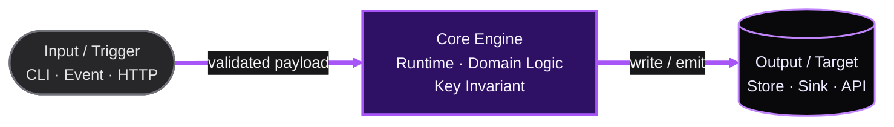

# Standalone Repository `README.md` Guide

Load this reference during **Phase 4** when authoring or maturing the graduated repository's root `README.md`.

## Principles
- **Standalone voice:** Write as a first-class repository—remove all monorepo subdirectory prefixes (`./<source_dir>/...` → `./...`), remove playground-only "Graduating to a Standalone Repository" sections, and make every relative link resolve from the new repo root.
- **Right-sized to the project:** Include only sections that carry real signal. A small utility/library needs ~60–120 lines (Overview, Layout, Quick Start, Verification); a multi-component service, agent, or IaC platform benefits from an Architecture Mermaid diagram, Component Reference table, Configuration table, and CI/CD or Runbook sections.
- **Copy-pasteable commands:** Every command in Quick Start and Verification must be empirically tested in Phase 5 from the standalone repo root.
- **No filler:** Skip generic badges, boilerplate "Contributing" templates, or repetitive prose unless the user asks for them.

---

## Adaptive Template

```markdown
# <Project Title>

<1–3 sentence summary: what this project does, the core stack, and the primary problem it solves.>

## Key Capabilities
- **<Capability 1>:** <Concrete behavior or architectural invariant>
- **<Capability 2>:** <Concrete behavior or architectural invariant>
- **<Capability 3>:** <Concrete behavior or architectural invariant>

## Architecture Overview
<!-- Include for multi-component services, agents, data pipelines, or IaC platforms; omit for tiny single-module utilities. -->
<!-- Keep Mermaid diagrams clean (flowchart TD/LR, sequenceDiagram, or erDiagram) with quoted labels when using parentheses/brackets. -->



## Repository Layout

```text
<repo-name>/
├── .github/workflows/   # CI/CD workflows (if applicable)
├── src/                 # Core implementation (adapt to actual tree)
├── tests/               # Automated tests
├── specs/               # Design specs / ADRs (if present)
└── README.md
```

## Prerequisites

- <Runtime / CLI versions, e.g., Python 3.12 + `uv`, OpenTofu >= 1.12 + Terragrunt, Java 21 + Maven>
- <Required auth or credentials, if any>

## Quick Start

```bash
# 1. Install / initialize
<exact setup command>

# 2. Configure local environment (if applicable)
cp .env.example .env

# 3. Run
<exact invocation example>
```

## Configuration
<!-- Include if the project uses env vars, config files, or GitHub Actions variables. -->

| Variable / File | Required | Default | Description |
| :--- | :--- | :--- | :--- |
| `EXAMPLE_VAR` | Yes | — | <What it controls> |

## Quality & Verification

```bash
# Format, lint, static analysis & tests (run locally from repo root)
<exact verified commands>
```

## CI/CD & Release Workflow
<!-- Include if .github/workflows/ was migrated or tag-based promotion is used. -->
- **Pull Requests:** <What checks/plans run automatically>
- **Main / Releases:** <How deploys, tags, or environment promotions work>

## Documentation & Specs
<!-- Include if specs/, docs/, or runbooks exist. -->
- [<Doc Title>](./docs/<file>.md)
```

---

## Final README Polish Check
Before committing in Phase 4, verify:
1. Zero broken relative links (`./...`, no leftover `../../` escaping repo root).
2. Zero stale monorepo commands or `<source_dir>/` prefixes.
3. Configuration tables match `.env.example` / `config.example.yaml` / `*.tfvars.example` / workflow `vars.*`.
4. Every verification command listed in the README actually passes in Phase 5.
