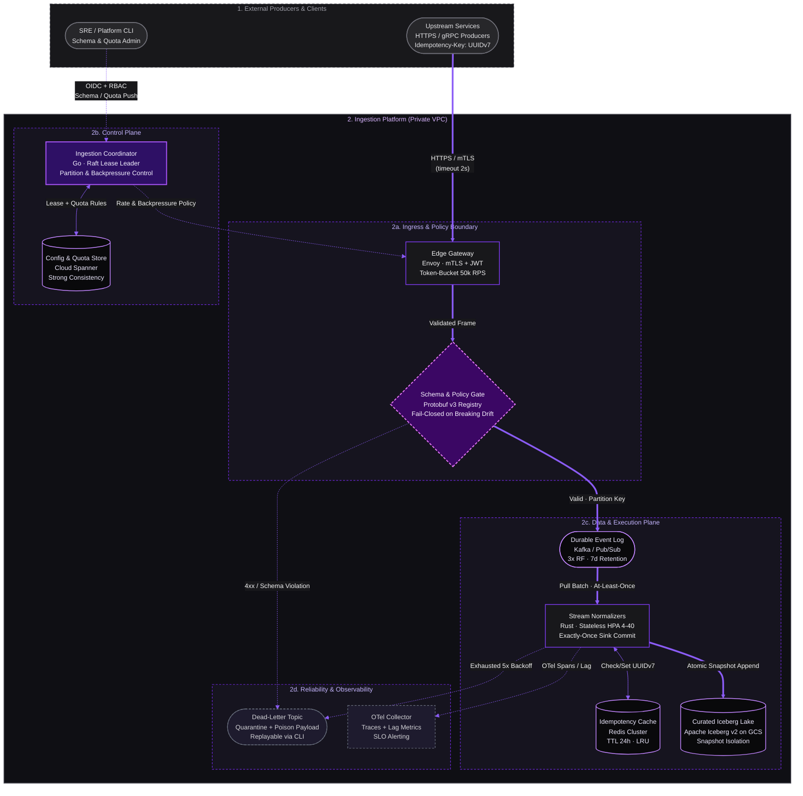
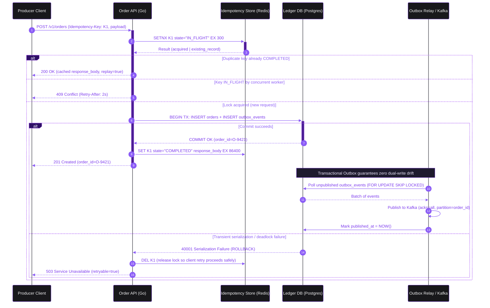
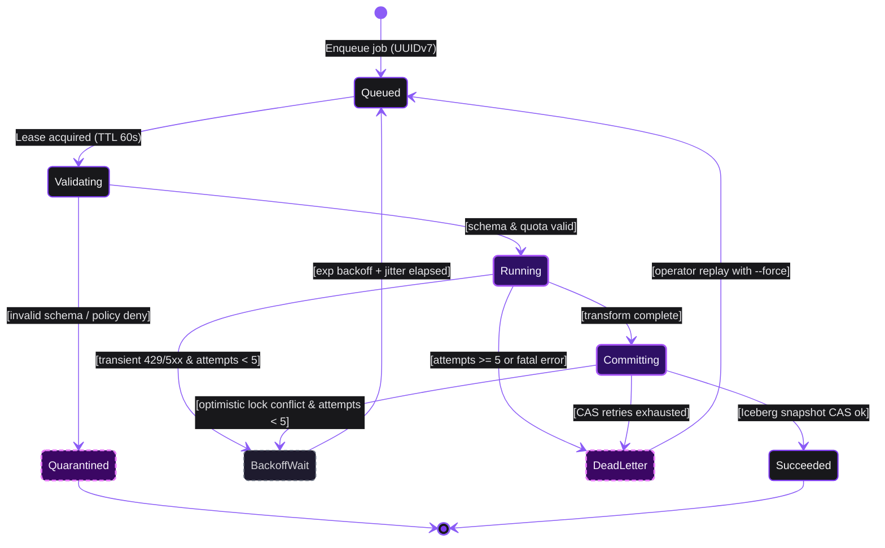
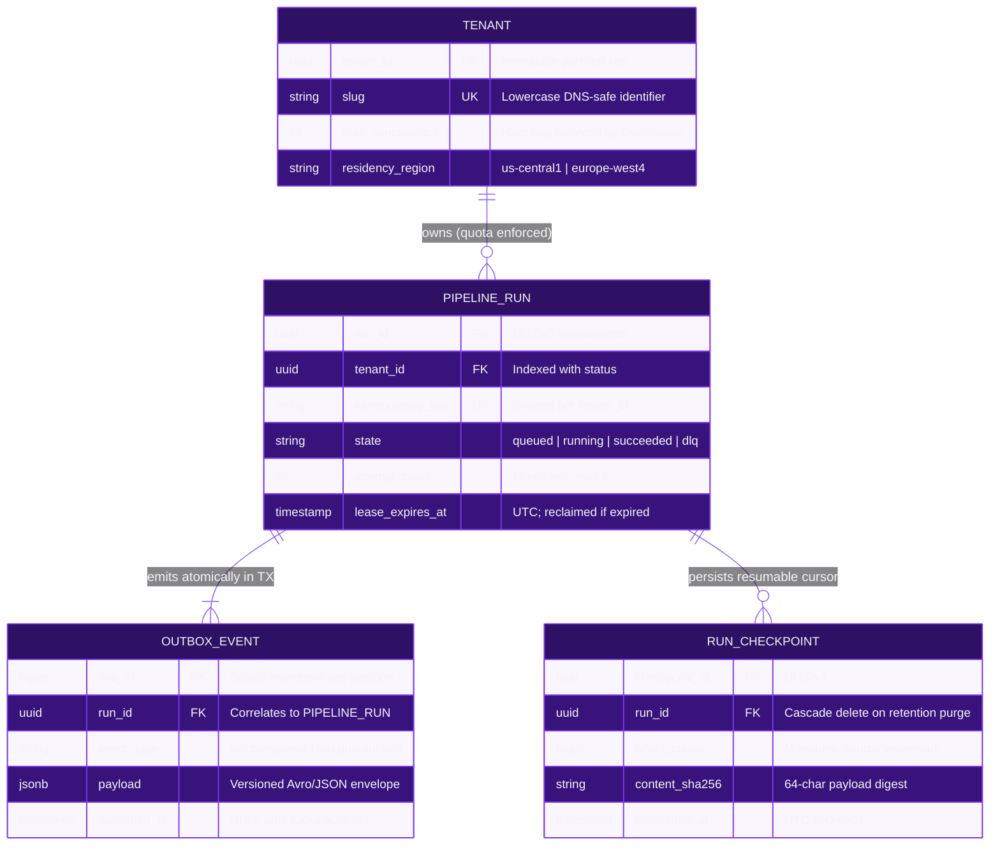
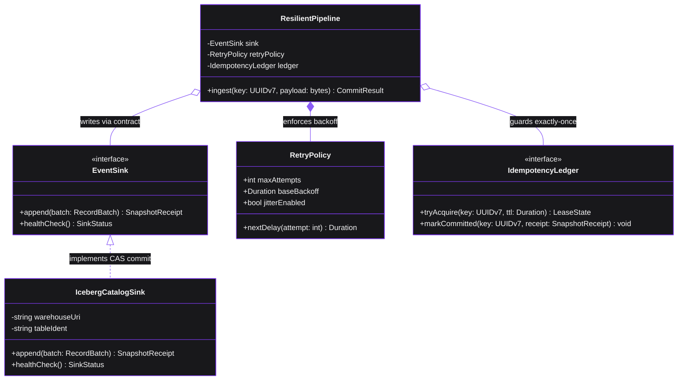

# Staff-Grade Mermaid Exemplars (Obsidian Violet Theme)

Production-ready reference templates for all 5 universal Mermaid diagram archetypes. Load only the section matching the diagram you are creating. Every block below passes `scripts/validate_mermaid.py --strict-warnings`.

---

## 1. System Architecture Topology (`flowchart TB`)

Demonstrates trust zones, Control vs. Data Plane separation, explicit guardrails, sync/hot/async edge semantics, and 3-line Staff node labels.

*Arrow Legend: Thick solid (`==>`) = primary hot/write data path · Solid (`-->`) = synchronous RPC/lookup · Dashed (`-.->`) = async event, policy push, DLQ, or telemetry.*

---

## 2. Protocol & Failure-Mode Sequence (`sequenceDiagram`)

Demonstrates `autonumber`, `alt`/`opt` branching for deduplication and transient retries, activation bars, and dual-canvas legible purple/grey styling.

---

## 3. Job / Workflow Lifecycle State Machine (`stateDiagram-v2`)

Demonstrates explicit transition guards `[condition]`, retry budgets, quarantine/terminal states, and `classDef` tiering.

---

## 4. Domain & Persistence Data Model (`erDiagram`)

Demonstrates clean cardinality, `PK`/`FK`/`UK` markers, and invariant comments on every non-obvious column.

---

## 5. Component & Interface Hierarchy (`classDiagram`)

Focuses on public contracts, composition, and failure/extension seams rather than noisy getter/setter boilerplate.

