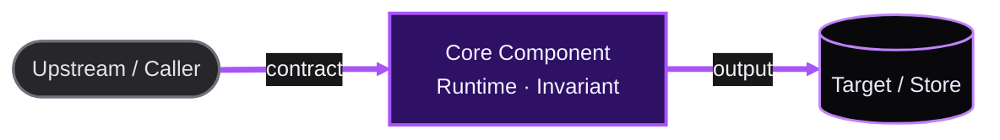

# Spec Template: Preview-First Core Skeleton + Archetype Contract Modules

Use this structure when drafting a spec in `specs/NN_<feature_name>.md`.

> **CRITICAL RULES:**
> 1. **No application source code blocks:** Never include application code (`java`, `python`, `typescript`, `go`, `rust`, HCL resource blocks, etc.). Express contracts via compact tables, bullet blueprints, and prose. Allowed fenced blocks: `mermaid`, `text` (trees), and external wire/config payloads (`yaml`, `json`, `toml`, `properties`, `protobuf`, `bash` CLI usage).
> 2. **Preview-First Readability (GitHub + IDE + Obsidian):**
>    - **Design before details:** Always open Section 1 with a 2–3 sentence **TL;DR**, an **Obsidian Violet dark-mode Mermaid diagram** (using the `mermaid-diagrams` skill), and concise **Key Design Decisions**.
>    - **No comma-list bullets:** Bullets are strictly for clean, plain-English sentences (1–2 lines max). Whenever an item enumerates **3+ attributes, commands, APIs, labels, or validation patterns**, convert it into a compact Markdown table instead of a comma-separated bullet.
>    - **Structured Requirements (`ID | What | Why | How`):** Format Section 3 (`Functional Requirements`) as compact 4-column tables grouped by theme so every requirement shows capability, rationale, and approach at a glance.
>    - **Single Source of Truth (no repetition):** Keep `How` cells at the architectural mechanism level and put exact field names, types, defaults, and validation rules **once** in Section 4 (Contract). Never re-state the same attribute list in Scope, Requirements, Contract, and Acceptance.
>    - **Narrow-pane tables:** Max **3–4 compact columns**, **one symbol per row** (never slash-combine multiple inputs/outputs into one row), separate **Inputs** and **Outputs** into distinct tables, and keep every table cell crisp (1–2 lines, putting regexes in their own compact table rather than a comma-list paragraph).
> 3. **Spec Sizing & Chunking Guardrails:**
>    - **Mini-Spec:** ~100–180 lines, **5–10** `REQ-*` / `TC-*` (1 focused feature, plugin, or bounded change — 1 PR).
>    - **Full Spec:** ~180–260 lines, **10–15** `REQ-*` / `TC-*` (1 cohesive module or subsystem — 1–2 PRs).
>    - **Split Threshold (> ~260 lines or > 15 `TC-*`):** Treat as an Epic (`00_` architecture parent + 2–4 sequential Mini-Specs split along lifecycle, blast-radius, or module boundaries).
> 4. **Spec Altitude Rule:** Lock **public contracts, module boundaries, invariants, and observable `TC-*` behaviors**—never over-specify private helpers or internal decomposition.

---

## Core Skeleton

```markdown
# Spec NN: <Short, Scannable Feature Name>

| Field | Value |
| :--- | :--- |
| **Status** | `Draft (Pending Approval)` |
| **Owner** | <Owner Name> |
| **Component** | `<module/path>` · <Primary Stack / Runtime> |
| **Archetype / Tier** | <Archetype> · Mini-Spec (`5–10 TCs`) / Full Spec (`10–15 TCs`) |
| **Depends On** | [`<prior_spec.md>`](./<prior_spec.md>) |

---

## 1. Overview & Design

### TL;DR
<2–3 plain-English sentences: what problem exists right now, what this spec builds, and what downstream capability it unlocks.>

### Architecture
<!-- Always include an Obsidian Violet dark-mode Mermaid diagram (follow the `mermaid-diagrams` skill) so a reviewer grasps boundaries, wiring, and consumers in 10 seconds. -->



### Key Design Decisions
- **<Decision 1>:** <1 short sentence on *why* this approach over the obvious alternative.>
- **<Decision 2>:** <1 short sentence on the key boundary, cost, or security trade-off.>

### Done Looks Like
- <Objective build/lint/test command passes cleanly.>
- <Key observable integration contract is satisfied (`TC-001`–`TC-NNN`).>

---

## 2. Scope

### In Scope
- <Crisp 1-line deliverable>
- <Crisp 1-line deliverable>

### Out of Scope (Non-Goals)
- <Explicit boundary preventing scope creep — 1 line>
- <Deferred concern and which follow-up spec owns it — 1 line>

---

## 3. Functional Requirements

<!-- Group requirements under short ### subheadings by component/theme using compact
     4-column tables (ID | What | Why | How). Keep each cell concise (1-2 lines max);
     put exact parameter names, defaults, and regexes ONCE in Section 4. -->

### <Theme / Component A>

| ID | What | Why | How |
| :--- | :--- | :--- | :--- |
| `REQ-01` | <Short capability> | <Risk prevented or value unlocked> | <High-level mechanism; details in §4> |
| `REQ-02` | <Short capability> | <Risk prevented or value unlocked> | <High-level mechanism; details in §4> |

### <Theme / Component B>

| ID | What | Why | How |
| :--- | :--- | :--- | :--- |
| `REQ-03` | <Short capability> | <Risk prevented or value unlocked> | <High-level mechanism; details in §4> |

---

## 4. Contract & Blueprint

<!-- Choose the matching narrow-pane Archetype Contract Module below.
     Rules: max 3–4 columns, one symbol per row, separate Inputs & Outputs tables,
     concise bullet cards for component config details, external payloads only. -->

---

## 5. Invariants & Failure Modes

### Key Invariants
- **<Invariant Name>:** <1 concise line — immutability, cost, security, or isolation rule.>
- **<Invariant Name>:** <1 concise line.>

### Failure Modes

| Condition | Expected Behavior | Guarantee |
| :--- | :--- | :--- |
| <Invalid input or config> | <Deterministic error / rejection> | <Fails fast; zero mutation> |
| <Upstream / dependency issue> | <Guard or explicit failure> | <No partial state> |

---

## 6. Acceptance & Verification (`TC-*`)

<!-- Keep to 3 compact columns. Tag related REQ-* IDs inside the Case column for traceability. -->

| Case | Scenario | Pass Condition |
| :--- | :--- | :--- |
| `TC-001` (`REQ-01`) | <Short scenario name> | <Concrete, verifiable pass assertion> |
| `TC-002` (`REQ-02`) | <Short scenario name> | <Concrete, verifiable pass assertion> |
| `TC-003` (`REQ-03`) | <Negative / failure case> | <Exact expected failure & zero mutation> |
```

---

## Archetype Contract Modules (Choose One for Section 4)

All tables below are deliberately capped at **3–4 narrow columns** with **one symbol per row** so they render cleanly in GitHub, VS Code, and Obsidian preview panes.

### A. Software Library Contract (Java / Python / TS / Go / Rust)
- **4.1 Package Layout:** Short `text` tree or bullet list of public packages/modules.
- **4.2 Public Domain Models:** One row per type (`| Type | Kind | Key Fields & Rules |`).
- **4.3 Public Interfaces / Ports:** One row per operation (`| Interface | Operation | Behavioral Contract |`).
- **4.4 Error Hierarchy:** One row per error (`| Error Type | Parent | When Thrown |`).
- **4.5 Config / Wire Payloads (Optional):** Short fenced `yaml` / `json` / `toml` / `protobuf` example.

### B. HTTP / gRPC API Service Contract
- **4.1 Endpoints / RPCs:** One row per endpoint (`| Endpoint / RPC | Auth | Idempotency | Errors |`).
- **4.2 Request & Response Payloads:** Short fenced `json` or `protobuf` payload examples.
- **4.3 Operational Limits:** Concise 3–4 bullet list (pagination, rate limits, timeouts).

### C. Data Pipeline / ETL Contract
- **4.1 Sources & Sinks:** One row per dataset (`| Role | System & Path | Format / Partitioning |`).
- **4.2 Transform & Quality Rules:** Compact numbered list (schema mapping, dedup key, quarantine/DLQ rule).
- **4.3 Idempotency & Backfill:** 3–4 short bullets (watermark, merge/overwrite mode, SLA).

### D. CLI Tool Contract
- **4.1 Subcommands:** One row per command (`| Command | Arguments | Exit Codes |`).
- **4.2 Flags:** One row per flag (`| Flag | Type & Default | Behavior |`).
- **4.3 Usage Examples:** Short fenced `bash` invocations + stdout/stderr format notes.

### E. Infrastructure-as-Code & GitOps Contract
- **4.1 Directory Layout:** Compact `text` tree scoped strictly to this spec's lifecycle tier.
- **4.2 Resource Blueprint Tables:** Compact 3-column tables for provisioned resources, side-by-side comparisons (e.g., bucket settings), enabled APIs, and mandatory labels (never comma-separated attribute bullets).
- **4.3 Stack Inputs:** Separate 4-column table, one variable per row (`| Input | Type | Default | Constraint |`), plus a compact 2-column **Validation Patterns** table if regexes apply.
- **4.4 Stack Outputs:** Separate 3-column table, one output per row (`| Output | Format / Value | Consumer |`).
- **4.5 IAM / Security Bindings:** Compact 3-column table (`| Principal | Scope & Role | Purpose |`).
- **4.6 Config & Consumer Payloads:** Short fenced `yaml` / `tfvars` / `properties` examples only (no HCL resource blocks).
